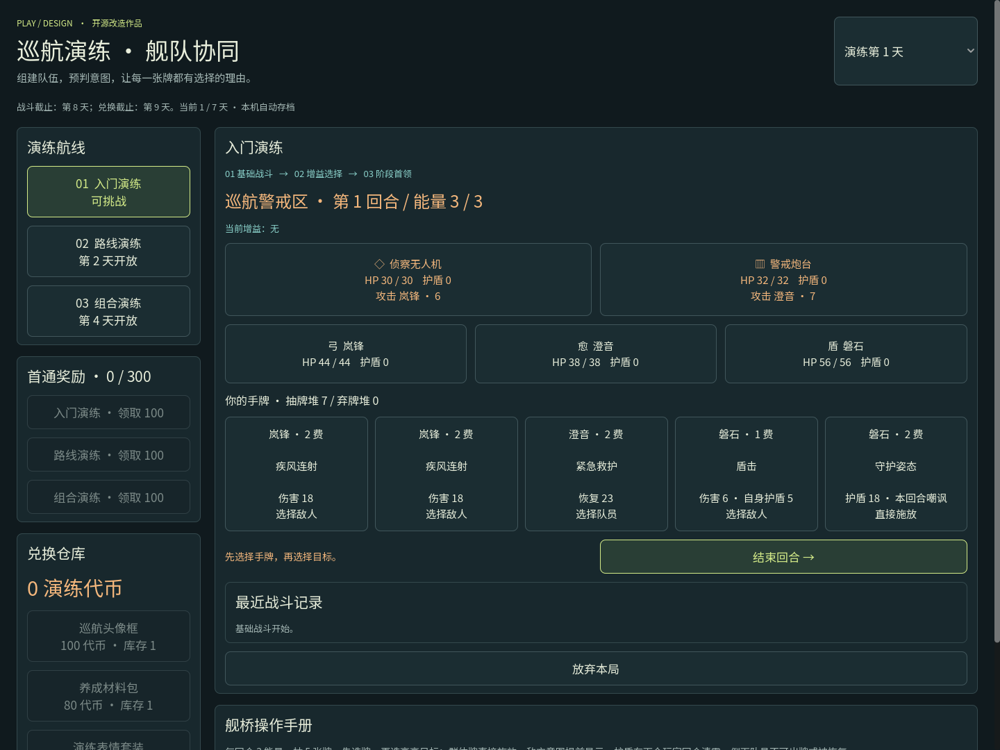

# 巡航演练 · 舰队协同

三人小队回合制卡牌原型，展示队伍配置、路线选择、分阶段增益与活动奖励闭环。

**[在线试玩](https://wangdi999.github.io/cruise-drill/) · [下载 Windows / 网页离线版](https://github.com/wangdi999/cruise-drill/releases/latest)**



## 开始试玩

在线版使用现代桌面浏览器打开，首次访问会自动刷新一次以准备运行环境；完整加载约需 33 MB 运行资源。

Releases 中的 Windows ZIP 解压后双击 `巡航演练.exe`。网页离线 ZIP 解压后双击 `开始游戏.bat`，使用 Windows 自带 PowerShell 启动，不需要安装开发工具。

玩法：六名固定试用角色选三人，至少一名输出；三人组成 12 张牌，每回合 3 能量、抽 5 张。先选手牌，再选目标；群体牌直接施放。每阶段为基础战、增益选择、首领战。阶段在第 1 / 2 / 4 天开放，顶部演练日用于快速展示时间边界。首通各 100，总额 300，对应三项兑换价格 100 / 80 / 120。第 8 天停止战斗，第 9 天停止兑换并转换剩余代币。

## 源码与构建

Godot **4.3 stable** 导入 `godot/project.godot` 后运行。`godot/cruise/data.json` 配置角色、技能、关卡与增益，`rules.gd` 实现战斗和奖励，`main.gd` 实现中文界面与存档。

本地网页预览（需要 Node.js）：

```sh
node server.cjs
```

打开 http://127.0.0.1:8090 。构建 Windows / Web 需要 Python，脚本仅在项目目录下载官方便携引擎与导出模板：

```sh
python -m pip install requests fonttools brotli playwright
python tools/bootstrap.py
python tools/subset_font.py
python tools/build.py
python tools/browser_test.py
```

`build.py` 重建常规 Web 导出；GitHub Pages 版 `web/play.html` 另有隔离环境入口适配，重新导出后运行 `node tools/prepare-pages.cjs` 恢复适配。编译后的 Web 运行文件已包含在仓库，可直接部署；Windows 大文件放在 Releases。

## 改造与归属

上游：[guladam/deck_builder_tutorial](https://github.com/guladam/deck_builder_tutorial)，固定提交 `91b408bc660e9b7389892dd4242a4d76e5bc9e77`，作者 Adam Gulacsi，MIT。

实际复用 Card、CardPile、Stats、CharacterStats、RNG 与修正器基础代码。7 个脚本原样保留，CharacterStats 的遗物类型只做一行兼容调整；新增队伍、卡牌效果、活动控制器和 GUI。原地图、拖拽界面、遗物及原战斗场景没有接入当前流程。代码在 AI 辅助下实现，详见 [改造说明](docs/改造说明.md)、[复用审计](artifacts/source-audit.json) 与 [差异文件](artifacts/upstream-changes.diff)。

新增代码 MIT 许可见根目录 LICENSE；上游声明见 `godot/LICENSE`，引擎第三方声明见 `LICENSES/`。中文字体来自 Noto Sans SC，子集改名 Portfolio Sans，采用 SIL OFL。GitHub Pages 隔离环境由 [coi-serviceworker](https://github.com/gzuidhof/coi-serviceworker) 提供，MIT 声明保留在 `LICENSES/`。

## 验证范围

已有 24 项核心检查、默认队伍固定策略 50 局完整战斗和 16 项 Chrome 实际点击检查；证据见 `artifacts/`。自动化不代表真人难度或线上运营结论，手机为桌面浏览器视口模拟。存档只在本机，演练日可手动切换，兑换品为原型占位。
